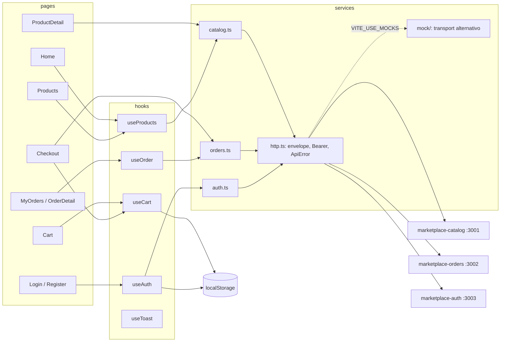

# marketplace-customer

Vitrine do comprador do [marketplace](https://github.com/DeborahDalonso/marketplace):
a landing, a lista de produtos, o carrinho, o checkout e o acompanhamento do
pedido. É uma SPA sem backend próprio; fala com `marketplace-catalog`,
`marketplace-orders` e `marketplace-auth` por REST e nunca lê banco de ninguém.
A marca da vitrine é "Varal": etiquetas de papel penduradas numa corda, com
preço amarelo de feira.

## Stack

- React 18 e TypeScript em modo `strict`, empacotados pelo Vite 5
- React Router 6 para as rotas da SPA
- CSS puro com tokens em `:root`, tema claro e escuro, sem framework de UI
- Vitest com Testing Library e jsdom
- ESLint e Prettier
- Nginx no container, servindo o `dist/` com fallback para `index.html`

## Como rodar

```bash
cp .env.example .env
npm install
npm run dev          # http://localhost:3000, recarrega ao salvar
npm test
npm run lint
npm run build        # gera dist/
```

Sem os serviços de backend no ar, a vitrine roda com dados fixos:

```bash
VITE_USE_MOCKS=true npm run dev
```

No modo mock a conta de demonstração é `ana@varal.dev` com a senha `varal123`.
Os pedidos vivem em memória e avançam sozinhos na saga (pendente, confirmado,
pago) a cada 4 segundos, para a tela de acompanhamento ter o que mostrar.

Variáveis de ambiente (todas lidas em tempo de build pelo Vite, por isso o
prefixo `VITE_`):

| Variável | Padrão | Para quê |
|---|---|---|
| `VITE_CATALOG_URL` | `http://localhost:3001` | produtos, categorias e registro de visualização |
| `VITE_ORDERS_URL` | `http://localhost:3002` | criação e consulta de pedidos |
| `VITE_AUTH_URL` | `http://localhost:3003` | login e cadastro |
| `VITE_USE_MOCKS` | `false` | `true` troca o cliente HTTP por dados fixos em `src/services/mock/` |

Com Docker:

```bash
docker build -t marketplace-customer \
    --build-arg VITE_CATALOG_URL=http://localhost:3001 \
    --build-arg VITE_ORDERS_URL=http://localhost:3002 \
    --build-arg VITE_AUTH_URL=http://localhost:3003 .
docker run -p 3000:3000 marketplace-customer
```

> [!NOTE]
> As URLs entram no bundle na hora do build. Para apontar a imagem para outro
> ambiente é preciso construir de novo com outros `--build-arg`.

## Arquitetura



Uma página usa um hook ou chama um service direto; o service monta a URL e
delega ao `http.ts`, que é o único lugar que conhece o envelope
`{ success, message, data }` e o header `Authorization`. O modo mock troca só
a função de transporte, então o tratamento do envelope é o mesmo nos dois
caminhos.

```
src/
  main.tsx              providers (Toast, Auth, Cart) e instalação dos mocks
  App.tsx               layout: header, outlet, footer, drawer, toasts
  routes.tsx            rotas e o guard RequireAuth
  components/           peças reutilizadas (ProductCard, CartDrawer, Toast...)
  contexts/             estado compartilhado: sessão, carrinho, avisos
  hooks/                useCart, useAuth, useProducts, useOrder, useTheme...
  i18n/pt-BR.ts         todo texto da interface
  lib/                  format (BRL, datas, ids) e validate (formulários)
  pages/                uma pasta plana, um arquivo por rota
  services/             catalog, orders, auth e o http.ts que fala com a rede
  services/mock/        dados fixos e transporte em memória
  styles/               tokens.css, base.css e um .css por componente e página
  types/                contratos de dados (Product, Order, User, ApiResponse)
tests/                  espelha src/; setup.ts limpa DOM e localStorage
docker/nginx.conf       fallback de SPA para o container
```

## Rotas da SPA

| Rota | Página | Precisa de login | Chama |
|---|---|---|---|
| `/` | Home | não | `GET /products`, `GET /categories` |
| `/produtos` | Products | não | `GET /products?q&categoryId&page&perPage` |
| `/produtos/:id` | ProductDetail | não | `GET /products/:id`, `POST /products/:id/views` |
| `/carrinho` | Cart | não | nada, só localStorage |
| `/entrar` | Login | não | `POST /auth/login` |
| `/cadastro` | Register | não | `POST /auth/register` |
| `/checkout` | Checkout | sim | `POST /orders` |
| `/pedidos` | MyOrders | sim | `GET /orders/mine` |
| `/pedidos/:id` | OrderDetail | sim | `GET /orders/:id`, a cada 5 s enquanto pendente ou confirmado |
| `*` | NotFound | não | nada |

Busca, categoria e página ficam na query string, então a lista é compartilhável
e o botão voltar funciona. Rotas protegidas mandam para `/entrar?next=...` e
voltam depois do login.

## Decisões

- CSS puro em vez de Tailwind ou biblioteca de componentes: o visual do Varal
  (etiquetas, prendedores, corda) é desenhado à mão e não cabe em utilitários;
  tokens em `:root` resolvem tema e consistência sem build extra.
- Context em vez de Redux ou Zustand: são três estados globais pequenos
  (sessão, carrinho, avisos) e nenhum deles cresce. Uma dependência a menos.
- Mocks locais trocando só o transporte: a tela inteira roda sem backend e os
  testes de página usam o mesmo caminho do envelope que a produção.
- Carrinho em localStorage: o comprador anônimo fecha a aba e volta amanhã com
  o carrinho intacto; só o pedido vai para o servidor.
- Polling de 5 s no detalhe do pedido em vez de WebSocket: a saga dura
  segundos e o `orders` não expõe canal de eventos para o navegador. Para
  quando o pedido chega em `paid` ou `cancelled`.
- Token de acesso em memória, sessão no localStorage: o `http.ts` não lê o
  storage em cada chamada; o `AuthContext` restaura o token ao montar.
- Visualização de produto é fire-and-forget: a tela não espera a resposta de
  `POST /products/:id/views` nem avisa se falhar.
- CSS fora do Prettier: o guia da casa pede regra curta numa linha só, e o
  Prettier expande todas. ESLint e Prettier cobrem o TypeScript.
- Fontes pelo Google Fonts (permitido pelo guia): três famílias com pesos
  variáveis pesariam mais no repositório do que no primeiro carregamento.

## Testes

```bash
npm test
```

Vitest com jsdom. Nenhum teste faz `vi.mock` de módulo: o `http.ts` aceita um
transporte alternativo e o `fetch` global é substituído por uma função que
grava a chamada.

| Arquivo | O que cobre |
|---|---|
| `tests/lib/format.test.ts` | BRL, datas e id curto |
| `tests/lib/validate.test.ts` | e-mail, campos obrigatórios e senha curta |
| `tests/hooks/useCart.test.tsx` | adiciona, junta, remove, soma, persiste e recupera do localStorage |
| `tests/services/http.test.ts` | envelope de sucesso e de erro, `ApiError` tipado, Bearer, query e falha de rede |
| `tests/components/ProductCard.test.tsx` | link, preço, faixas de estoque e botão de adicionar |
| `tests/pages/Checkout.test.tsx` | sem login redireciona; com login envia o pedido pelo mock e mostra pendente |

## Licença

MIT
